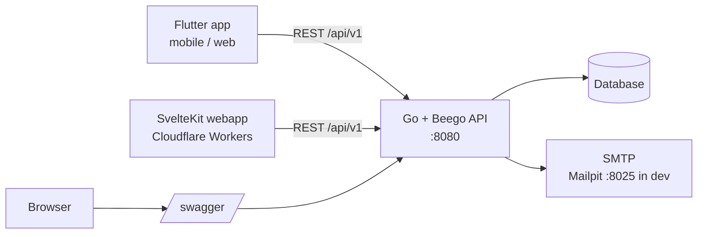

# go-rest-template

A SaaS starter template: a Go/Beego REST API with complete authentication, a Flutter app and a SvelteKit webapp deployed to Cloudflare Workers. Click "Use this template" and start building your product instead of re-implementing login.

## Features

- Email/password auth with registration
- Email verification and password reset (Mailpit for local dev)
- JWT access tokens with refresh token rotation and reuse detection
- TOTP two-factor auth with recovery codes
- Passkeys (WebAuthn) for login and as an MFA factor
- Sign in with Google (web, iOS, Android), verified server-side, never bypasses 2FA; disabled until configured
- TOTP replay protection, rate limiting on auth endpoints, audit log, strict CSP
- Admin API and admin UI
- OpenAPI/Swagger docs at `/swagger/`
- Flutter app (Android, iOS, web) with biometric unlock (Face ID / Touch ID / fingerprint)
- SvelteKit webapp on Cloudflare Workers
- GitHub Actions CI and tag-driven releases

## Architecture



## Quick start

```bash
docker-compose up        # API on http://localhost:8080, Mailpit UI on http://localhost:8025
```

Then, in another terminal:

```bash
# Flutter
cd flutter_app && flutter pub get && flutter run

# Webapp
cd webapp && npm ci && npm run dev
```

Swagger UI: http://localhost:8080/swagger/

<!-- template-only:start -->
## Using this template

There are two ways to start a new project. Both rename the Go module, app name, Flutter package and
bundle id, Cloudflare worker, LICENSE author and API contact email, move the Android `MainActivity`
and regenerate the swagger docs.

### Option A: Copier (recommended)

```bash
uvx copier copy --trust gh:lingster/go-rest-template my-app   # or: pipx run copier copy --trust ...
cd my-app && git init && git add -A && git commit -m "chore: initialise project from template"
```

Copier asks for the project name, slug, GitHub owner, Go module, Dart package, bundle id, worker name,
author and email (sensible defaults are derived from the name, e.g. `6-Pack App` gives
`six_pack_app` and `com.<owner>.sixpackapp`). `--trust` is needed because the template runs
`scripts/init_project.py` after copying. Add `--vcs-ref main` to use the latest `main` instead of the
latest release tag.

### Option B: GitHub "Use this template"

1. Click **Use this template** on GitHub, create your repository and clone it.
2. Run the init script from the repo root (Python 3 standard library only):

   ```bash
   python3 scripts/init_project.py                       # interactive prompts
   python3 scripts/init_project.py --name "6-Pack App" --owner acme --yes   # or with flags
   ```

   `--dry-run` shows what would change. The script removes itself and `copier.yml` when done. Install
   `bee` (`go install github.com/beego/bee/v2@latest`) first so it can regenerate swagger, or run
   `make docs` in `backend/` afterwards.

<!-- template-only:end -->
## Google sign-in setup

The code ships in every project but is **disabled until `GOOGLE_CLIENT_IDS` is set** on the API. The API verifies Google ID
tokens itself (signature via Google's JWKS, issuer, audience, expiry, `email_verified`), so no client secret is needed anywhere.

1. **Google Cloud console** ([console.cloud.google.com](https://console.cloud.google.com)): create or pick a project, then
   *APIs & Services > OAuth consent screen* (Google Auth Platform > Branding/Audience): app name, support email, authorised
   domains; the default scopes `openid`, `email`, `profile` are enough. While the app is in *Testing*, add your Google accounts as
   test users; publish it for everyone.
2. *Credentials > Create credentials > OAuth client ID*, create one client per platform you ship:
   - **Web application**: add *Authorised JavaScript origins* for the webapp (`http://localhost:5173`, `https://app.example.com`).
     No redirect URI is needed for the button flow. This is the **web client ID** (also the `serverClientId` for Android/iOS).
   - **iOS**: your bundle id (`bundle_id` from the generator). Note the client ID and the *reversed client ID*
     (`com.googleusercontent.apps.<id>`).
   - **Android**: your application id and the **SHA-1** of each signing key you will install the app with: the debug keystore
     (`keytool -list -v -keystore ~/.android/debug.keystore -alias androiddebugkey -storepass android`), your release/upload key,
     and, if you use **Play App Signing**, the *app signing key* SHA-1 shown in Play Console > Setup > App signing. Add one
     Android client per key set (or one per package + SHA-1). Add the SHA-256 too if the console asks for it.
3. **API** environment: `GOOGLE_CLIENT_IDS=<web id>,<ios id>[,<android id>]`. The **first** entry must be the web client ID
   (it is advertised to clients by `GET /api/v1/auth/providers`); the others are accepted as token audiences. Android sign-in
   issues tokens with the *web* client as audience, so the Android client ID is optional here.
4. **Webapp**: build with `PUBLIC_GOOGLE_SIGNIN=true` (adds `accounts.google.com` to the CSP: `script-src`, `frame-src`,
   `connect-src`, `style-src`; no `unsafe-inline`). The button appears when the API reports Google enabled. Do not send
   `Cross-Origin-Opener-Policy: same-origin` on the webapp (it breaks the Google popup).
5. **Flutter** (iOS/Android): pass `GOOGLE_SERVER_CLIENT_ID` (web client ID) and `GOOGLE_IOS_CLIENT_ID` with
   `--dart-define-from-file=config/app.local.json` (copy `flutter_app/config/app.example.json`), and for iOS create
   `flutter_app/ios/Flutter/Google.local.xcconfig` (see [flutter_app/README.md](flutter_app/README.md)). CI/release builds read the
   repository variables `GOOGLE_SERVER_CLIENT_ID`, `GOOGLE_IOS_CLIENT_ID` and `PUBLIC_GOOGLE_SIGNIN`.
6. Copier users can answer *google_signin* (and the client IDs) to have these examples pre-filled; leaving it off keeps the feature disabled.

Behaviour: accounts are matched by Google `sub`; otherwise by email (the Google identity is linked and the email marked verified);
otherwise a new account is created without a password. Users with TOTP still complete the 2FA step. Google-created accounts
set a password through "forgot password"; see [docs/SECURITY.md](docs/SECURITY.md).

## Before deploying

For every environment, set:

- [ ] `JWT_SECRET` (long random value, unique per environment)
- [ ] WebAuthn RP ID and allowed origins for your real domain(s)
- [ ] Cloudflare secrets and repository variables (see below)

## CI/CD

`.github/workflows/ci.yml` runs on pull requests and pushes to `main`. On PRs only the changed project(s) run; on `main` everything runs. The backend job runs `go vet`, `go test`, verifies Swagger docs are current (`make docs`) and builds the Docker image.

Configure under **Settings > Secrets and variables > Actions**:

| Name | Kind | Used for |
|---|---|---|
| `CLOUDFLARE_API_TOKEN` | secret | Deploy webapp with wrangler (deploy is skipped if unset) |
| `CLOUDFLARE_ACCOUNT_ID` | secret | Cloudflare account for deploy |
| `PUBLIC_API_URL` | variable | API URL baked into the webapp at build time |
| `API_BASE_URL` | variable | API URL baked into Flutter web/APK builds |
| `PUBLIC_GOOGLE_SIGNIN` | variable | `true` allows Google Identity Services in the webapp CSP (optional) |
| `GOOGLE_SERVER_CLIENT_ID` / `GOOGLE_IOS_CLIENT_ID` | variable | Google client IDs baked into the Flutter APK (optional) |

### Release process

1. Create a GitHub release with a tag `vX.Y.Z` and publish it.
2. `.github/workflows/release.yml` then attaches to that release:
   - Go server archives (linux/darwin/windows, amd64/arm64) and `checksums.txt` via GoReleaser
   - `flutter-web-<tag>.zip` and `app-<tag>.apk`
   - `webapp-<tag>.zip`, and deploys the webapp to Cloudflare Workers
3. Re-run manually via **Actions > Release > Run workflow** with an existing tag if needed.

## Documentation

- [backend/README.md](backend/README.md)
- [flutter_app/README.md](flutter_app/README.md)
- [webapp/README.md](webapp/README.md)
- [docs/API_CONTRACT.md](docs/API_CONTRACT.md)
- [docs/SECURITY.md](docs/SECURITY.md)

## License

[MIT](LICENSE)
