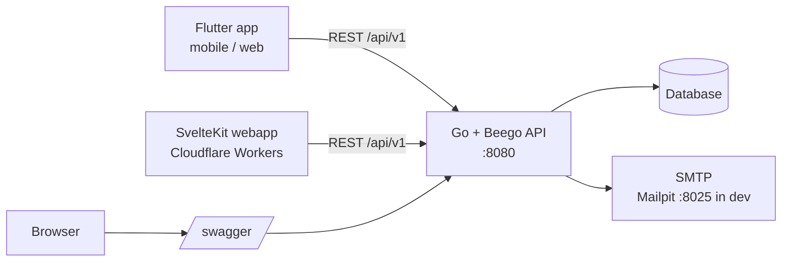

# go-rest-template

A SaaS starter template: a Go/Beego REST API with complete authentication, a Flutter app and a SvelteKit webapp deployed to Cloudflare Workers. Click "Use this template" and start building your product instead of re-implementing login.

## Features

- Email/password auth with registration
- Email verification and password reset (Mailpit for local dev)
- JWT access tokens with refresh token rotation and reuse detection
- TOTP two-factor auth with recovery codes
- Passkeys (WebAuthn) for login and as an MFA factor
- TOTP replay protection, rate limiting on auth endpoints, audit log, strict CSP
- Admin API and admin UI
- OpenAPI/Swagger docs at `/swagger/`
- Flutter app (Android, iOS, web) with biometric unlock (Face ID / Touch ID / fingerprint)
- SvelteKit webapp on Cloudflare Workers
- GitHub Actions CI and tag-driven releases

## Architecture



## Quick start

```bash
docker-compose up        # API on http://localhost:8080, Mailpit UI on http://localhost:8025
```

Then, in another terminal:

```bash
# Flutter
cd flutter_app && flutter pub get && flutter run

# Webapp
cd webapp && npm ci && npm run dev
```

Swagger UI: http://localhost:8080/swagger/

## Using this template

1. Click **Use this template** on GitHub and create your repository.
2. Work through this checklist of renames and settings:
   - [ ] Go module path in `backend/go.mod` and all imports (also `.goreleaser.yaml` ldflags if you rename `main` variables)
   - [ ] Flutter package name and Android application id / iOS bundle id
   - [ ] Worker `name` in `webapp/wrangler.*`
   - [ ] `JWT_SECRET` (long random value, unique per environment)
   - [ ] WebAuthn RP ID and allowed origins to your real domain(s)
   - [ ] Cloudflare secrets and repository variables (see below)
   - [ ] Update `LICENSE` copyright holder

## CI/CD

`.github/workflows/ci.yml` runs on pull requests and pushes to `main`. On PRs only the changed project(s) run; on `main` everything runs. The backend job runs `go vet`, `go test`, verifies Swagger docs are current (`make docs`) and builds the Docker image.

Configure under **Settings > Secrets and variables > Actions**:

| Name | Kind | Used for |
|---|---|---|
| `CLOUDFLARE_API_TOKEN` | secret | Deploy webapp with wrangler (deploy is skipped if unset) |
| `CLOUDFLARE_ACCOUNT_ID` | secret | Cloudflare account for deploy |
| `PUBLIC_API_URL` | variable | API URL baked into the webapp at build time |
| `API_BASE_URL` | variable | API URL baked into Flutter web/APK builds |

### Release process

1. Create a GitHub release with a tag `vX.Y.Z` and publish it.
2. `.github/workflows/release.yml` then attaches to that release:
   - Go server archives (linux/darwin/windows, amd64/arm64) and `checksums.txt` via GoReleaser
   - `flutter-web-<tag>.zip` and `app-<tag>.apk`
   - `webapp-<tag>.zip`, and deploys the webapp to Cloudflare Workers
3. Re-run manually via **Actions > Release > Run workflow** with an existing tag if needed.

## Documentation

- [backend/README.md](backend/README.md)
- [flutter_app/README.md](flutter_app/README.md)
- [webapp/README.md](webapp/README.md)
- [docs/API_CONTRACT.md](docs/API_CONTRACT.md)
- [docs/SECURITY.md](docs/SECURITY.md)

## License

[MIT](LICENSE)
