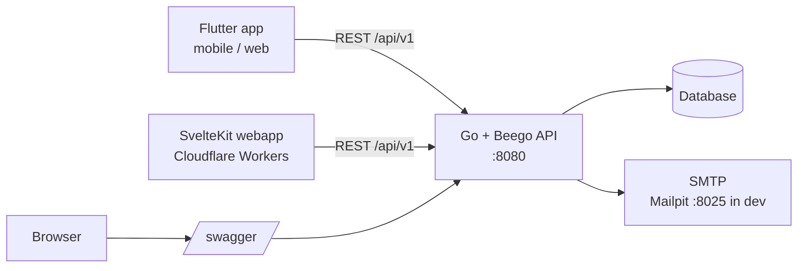

# go-rest-template

A SaaS starter template: a Go/Beego REST API with complete authentication, a Flutter app and a SvelteKit webapp deployed to Cloudflare Workers. Click "Use this template" and start building your product instead of re-implementing login.

## Features

- Email/password auth with registration
- Email verification and password reset (Mailpit for local dev)
- JWT access tokens with refresh token rotation and reuse detection
- TOTP two-factor auth with recovery codes
- Passkeys (WebAuthn) for login and as an MFA factor
- Sign in with Google (web, iOS, Android), verified server-side, never bypasses 2FA; disabled until configured
- TOTP replay protection, rate limiting on auth endpoints, audit log, strict CSP
- Admin API and admin UI
- OpenAPI/Swagger docs at `/swagger/`
- SEO landing page at `/` (plus `robots.txt` and `sitemap.xml`), driven by one JSON file
- Flutter app (Android, iOS, web) with biometric unlock (Face ID / Touch ID / fingerprint)
- SvelteKit webapp on Cloudflare Workers
- GitHub Actions CI and tag-driven releases
- Store pipeline: fastlane builds to TestFlight and Play internal testing, app-icon generation, rendered store screenshots, and ASO listing placeholders with a length/keyword checker (skipped until store secrets are set)

## Architecture



## Quick start

```bash
docker-compose up        # API on http://localhost:8080, Mailpit UI on http://localhost:8025
```

Then, in another terminal:

```bash
# Flutter
cd flutter_app && flutter pub get && flutter run

# Webapp
cd webapp && npm ci && npm run dev
```

Swagger UI: http://localhost:8080/swagger/

<!-- template-only:start -->
## Using this template

There are two ways to start a new project. Both rename the Go module, app name, Flutter package and
bundle id, Cloudflare worker, LICENSE author and API contact email, move the Android `MainActivity`
and regenerate the swagger docs.

### Option A: Copier (recommended)

```bash
uvx copier copy --trust gh:lingster/go-rest-template my-app   # or: pipx run copier copy --trust ...
cd my-app && git init && git add -A && git commit -m "chore: initialise project from template"
```

Copier asks for the project name, slug, GitHub owner, Go module, Dart package, bundle id, worker name,
author, email, tagline and landing page URL (sensible defaults are derived from the name, e.g. `6-Pack App` gives
`six_pack_app` and `com.<owner>.sixpackapp`). `--trust` is needed because the template runs
`scripts/init_project.py` after copying.

> **Note:** Copier uses the latest **release tag** by default, so changes merged to `main` after the last
> release are not included. Use `--vcs-ref main` for unreleased changes:
> `uvx copier copy --trust --vcs-ref main gh:lingster/go-rest-template my-app`.

### Option B: GitHub "Use this template"

1. Click **Use this template** on GitHub, create your repository and clone it.
2. Run the init script from the repo root (Python 3 standard library only):

   ```bash
   python3 scripts/init_project.py                       # interactive prompts
   python3 scripts/init_project.py --name "6-Pack App" --owner acme --yes   # or with flags
   python3 scripts/init_project.py --tagline "Lift smarter" --site-url https://acme.example --yes
   ```

   `--dry-run` shows what would change. The script removes itself and `copier.yml` when done. Install
   `bee` (`go install github.com/beego/bee/v2@latest`) first so it can regenerate swagger, or run
   `make docs` in `backend/` afterwards.

<!-- template-only:end -->
## Google sign-in setup

The code ships in every project but is **disabled until `GOOGLE_CLIENT_IDS` is set** on the API. The API verifies Google ID
tokens itself (signature via Google's JWKS, issuer, audience, expiry, `email_verified`), so no client secret is needed anywhere.

1. **Google Cloud console** ([console.cloud.google.com](https://console.cloud.google.com)): create or pick a project, then
   *APIs & Services > OAuth consent screen* (Google Auth Platform > Branding/Audience): app name, support email, authorised
   domains; the default scopes `openid`, `email`, `profile` are enough. While the app is in *Testing*, add your Google accounts as
   test users; publish it for everyone.
2. *Credentials > Create credentials > OAuth client ID*, create one client per platform you ship:
   - **Web application**: add *Authorised JavaScript origins* for the webapp (`http://localhost:5173`, `https://app.example.com`).
     No redirect URI is needed for the button flow. This is the **web client ID** (also the `serverClientId` for Android/iOS).
   - **iOS**: your bundle id (`bundle_id` from the generator). Note the client ID and the *reversed client ID*
     (`com.googleusercontent.apps.<id>`).
   - **Android**: your application id and the **SHA-1** of each signing key you will install the app with: the debug keystore
     (`keytool -list -v -keystore ~/.android/debug.keystore -alias androiddebugkey -storepass android`), your release/upload key,
     and, if you use **Play App Signing**, the *app signing key* SHA-1 shown in Play Console > Setup > App signing. Add one
     Android client per key set (or one per package + SHA-1). Add the SHA-256 too if the console asks for it.
3. **API** environment: `GOOGLE_CLIENT_IDS=<web id>,<ios id>[,<android id>]`. The **first** entry must be the web client ID
   (it is advertised to clients by `GET /api/v1/auth/providers`); the others are accepted as token audiences. Android sign-in
   issues tokens with the *web* client as audience, so the Android client ID is optional here.
4. **Webapp**: build with `PUBLIC_GOOGLE_SIGNIN=true` (adds `accounts.google.com` to the CSP: `script-src`, `frame-src`,
   `connect-src`, `style-src`; no `unsafe-inline`). The button appears when the API reports Google enabled. Do not send
   `Cross-Origin-Opener-Policy: same-origin` on the webapp (it breaks the Google popup).
5. **Flutter** (iOS/Android): pass `GOOGLE_SERVER_CLIENT_ID` (web client ID) and `GOOGLE_IOS_CLIENT_ID` with
   `--dart-define-from-file=config/app.local.json` (copy `flutter_app/config/app.example.json`), and for iOS create
   `flutter_app/ios/Flutter/Google.local.xcconfig` (see [flutter_app/README.md](flutter_app/README.md)). CI/release builds read the
   repository variables `GOOGLE_SERVER_CLIENT_ID`, `GOOGLE_IOS_CLIENT_ID` and `PUBLIC_GOOGLE_SIGNIN`.
6. Copier users can answer *google_signin* (and the client IDs) to have these examples pre-filled; leaving it off keeps the feature disabled.

Behaviour: accounts are matched by Google `sub`; otherwise by email (the Google identity is linked and the email marked verified);
otherwise a new account is created without a password. Users with TOTP still complete the 2FA step. Google-created accounts
set a password through "forgot password"; see [docs/SECURITY.md](docs/SECURITY.md).

## Customise your landing page

`GET /` serves a server-rendered, JavaScript-free marketing page, and the API also serves `/robots.txt` and
`/sitemap.xml`. Everything on it comes from **`backend/conf/landing.json`** (embedded in the binary) and ships
with obviously-placeholder copy, so replace it before launch. The generator fills the site name, tagline, URL
and publisher from your answers (`tagline`, `site_url`); the rest is yours to edit.

| Field | What it controls |
| --- | --- |
| `siteName`, `tagline`, `locale` | Brand name, one-line pitch, `lang` attribute and `og:locale` |
| `url` | Canonical site URL (https, ends in `/`); used for the canonical link, sitemap, robots and social tags |
| `title`, `description` | `<title>` and meta description. Title up to 60 characters, description up to 160 |
| `lastModified` | `YYYY-MM-DD` shown as sitemap `lastmod`; bump it when the content changes |
| `ogImage`, `icons` | Social share image (1200x630) and favicon / Apple touch icon paths under `/static/landing/img/` |
| `theme` | Nine `#RRGGBB` colours (background, text, muted, primary, accent, hero, heroLabel, card, line) |
| `fonts` | Optional bundled fonts (`family`, `faces`, `preload`); leave the families empty for the system font stack |
| `brand.logo`, `hero` | Header logo; hero eyebrow, headline, sub-headline, note and optional picture (empty `src` hides it) |
| `features`, `steps` | Section headings plus cards. `features.screenshots` is optional: an empty list hides the block |
| `pricing` | Section text plus the `price` and `currency` that go into the structured data |
| `faq` | Questions and answers, shown on the page and emitted as FAQ structured data |
| `stores` | App Store / Google Play URLs and labels, and the "coming soon" text |
| `app`, `publisher` | Structured-data app OS and category; publisher name, URL and contact email |
| `footer`, `robots` | Footer links and disclaimer; paths to `Disallow` in `robots.txt` |

**Images.** Replace the files in `backend/static/landing/img/` (keep the names, or update the paths in the JSON):
`og.png` (1200x630), `icon.svg`, `favicon-32.png` (32x32) and `apple-touch-icon.png` (180x180). Keep them small
(the placeholder og image is about 10 KB). To show screenshots, add files to the same folder and list them under
`features.screenshots` (and `hero.image`) with `src`, `alt`, `width` and `height`. A one-off conversion from SVG
works well: `uv run --with cairosvg python -c "import cairosvg; cairosvg.svg2png(url='og.svg', write_to='og.png', output_width=1200, output_height=630)"`.

**Store links.** The App Store and Google Play buttons stay hidden (the "coming soon" text is shown) until you
set the deploy-time switch `LANDING_STORE_LINKS_LIVE=true` on the API. Put your real store URLs in `stores` first.

**Validation.** The server validates the file at startup and refuses to start with a list of every problem
(missing fields, over-long title or description, bad colours or URLs, assets that do not exist). A Go test
(`landing` package) loads the committed file, so `go test ./...` catches mistakes in CI.

**Web app.** The webapp's SEO constants live in `webapp/src/lib/seo.ts` (`SITE_NAME`, `TAGLINE`, `WEB_ORIGIN`,
`MAIN_SITE_URL`); the generator sets them, assuming the web app is served at `app.<your domain>`. Its home page
canonicalises to the landing page, signed-in areas are `noindex` (meta tag and `_headers`), and
`/sitemap.xml` and `static/robots.txt` are generated for the web app origin.

**SEO checklist**

- [ ] Title is 60 characters or fewer and description is 160 or fewer (enforced by validation)
- [ ] `url` is your real production URL, with `https` and a trailing slash
- [ ] The og image is 1200x630 and is your own artwork (test it in a social card preview tool)
- [ ] Placeholder copy, pricing, FAQ and store URLs are replaced
- [ ] Submit `https://<your-domain>/sitemap.xml` in Google Search Console
- [ ] Run the page through Google's Rich Results Test (app and FAQ structured data)

## Before deploying

For every environment, set:

- [ ] `JWT_SECRET` (long random value, unique per environment)
- [ ] WebAuthn RP ID and allowed origins for your real domain(s)
- [ ] Cloudflare secrets and repository variables (see below)

## CI/CD

`.github/workflows/ci.yml` runs on pull requests and pushes to `main`. On PRs only the changed project(s) run; on `main` everything runs. The backend job runs `go vet`, `go test`, verifies Swagger docs are current (`make docs`) and builds the Docker image.

Configure under **Settings > Secrets and variables > Actions**:

| Name | Kind | Used for |
|---|---|---|
| `CLOUDFLARE_API_TOKEN` | secret | Deploy webapp with wrangler (deploy is skipped if unset) |
| `CLOUDFLARE_ACCOUNT_ID` | secret | Cloudflare account for deploy |
| `PUBLIC_API_URL` | variable | API URL baked into the webapp at build time |
| `API_BASE_URL` | variable | API URL baked into Flutter web/APK builds |
| `PUBLIC_GOOGLE_SIGNIN` | variable | `true` allows Google Identity Services in the webapp CSP (optional) |
| `GOOGLE_SERVER_CLIENT_ID` / `GOOGLE_IOS_CLIENT_ID` | variable | Google client IDs baked into the Flutter APK (optional) |

### Release process

1. Create a GitHub release with a tag `vX.Y.Z` and publish it.
2. `.github/workflows/release.yml` then attaches to that release:
   - Go server archives (linux/darwin/windows, amd64/arm64) and `checksums.txt` via GoReleaser
   - `flutter-web-<tag>.zip` and `app-<tag>.apk`
   - `webapp-<tag>.zip`, and deploys the webapp to Cloudflare Workers
3. Re-run manually via **Actions > Release > Run workflow** with an existing tag if needed.

<!-- store:start -->
## Ship to the stores

The repo includes a store release pipeline (fastlane, GitHub Actions): a published release builds and
uploads the app to TestFlight and the Google Play internal track, and manual workflows upload the store
listing. It stays dormant, and skips with a notice, until you add the secrets. Start with
[docs/STORES.md](docs/STORES.md) (accounts, keys, secrets, variables, runners), then
[docs/RELEASING.md](docs/RELEASING.md) and the [submission checklist](docs/STORE_SUBMISSION.md).

## Customise your store listing (ASO)

Everything below is placeholder content derived from your project name: edit it before you publish.

| What | Where |
|---|---|
| Play text (en-US) | `flutter_app/android/fastlane/metadata/android/en-US/` : `title.txt` (30 characters), `short_description.txt` (80), `full_description.txt` (4000) |
| Play images | `.../en-US/images/`: `icon.png` (512x512), `featureGraphic.png` (1024x500, no alpha), `phoneScreenshots/` (2 to 8 files, 1080x1920, no alpha) |
| App Store text (en-GB and en-US) | `flutter_app/ios/fastlane/metadata/<locale>/`: `name` (30), `subtitle` (30), `keywords` (100), `promotional_text` (170), `description` (4000), `release_notes`, and the `support`, `marketing` and `privacy` URLs (https) |
| App Store shared | `flutter_app/ios/fastlane/metadata/copyright.txt` and `primary_category.txt` (a category id such as `PRODUCTIVITY`) |
| App Store screenshots | `flutter_app/ios/fastlane/screenshots/<locale>/`: iPhone 1320x2868 and iPad 2064x2752, 1 to 10 each (the app targets both) |

`ruby tool/fastlane/listing_test.rb` checks the limits, URLs, keyword rules and image sizes, and CI runs it
(also on the project generated from this template).

**Keyword tips.** Apple already indexes your name and subtitle, so do not repeat their words in
`keywords.txt`; comma-separated, no spaces, singular (plurals are matched). The two locales deliberately use
**different** keyword sets: the UK storefront indexes en-GB and the US one en-US, so splitting words between
them doubles the terms you can rank for (the checker fails if they overlap). `keywords.txt` cannot hold
comments, which is why this explanation lives here. Lead the name, subtitle and first lines of the description
with what users search for, in plain words.

**Screenshots and feature graphic** are rendered from the app's real screens (sign-in, home, profile, security)
with fake providers by `flutter_app/test_store/`, which lives outside `test/` so a normal `flutter test` skips
it. Captions, routes, app name, tagline and brand colours are one list in `test_store/store_shots.dart`;
the fake user and data are in `test_store/support/fake_store_app.dart`. Regenerate from the repo root (needs
Docker, or run `flutter test test_store` in `flutter_app/` with a local Flutter) and look at every PNG before committing:

```sh
docker run --rm -v "$PWD":/app -w /app/flutter_app ghcr.io/cirruslabs/flutter:stable bash -c \
  "flutter pub get && flutter test test_store; chown -R $(id -u):$(id -g) /app"
```

**Swap the app icon.** Replace `flutter_app/assets/icon/icon.svg` (full-bleed square) and
`icon-foreground.svg` (transparent, artwork inside the central 66%), render `icon-1024.png` (no alpha) and
`icon-foreground.png` (1024x1024), then regenerate the platform icons and the 512px Play icon:

```sh
cd flutter_app
rsvg-convert -w 1024 -h 1024 assets/icon/icon.svg | convert - -alpha off assets/icon/icon-1024.png
rsvg-convert -w 1024 -h 1024 assets/icon/icon-foreground.svg -o assets/icon/icon-foreground.png
convert assets/icon/icon-1024.png -resize 512x512 android/fastlane/metadata/android/en-US/images/icon.png
dart run flutter_launcher_icons        # Android (adaptive), iOS and web icons, see flutter_launcher_icons.yaml
```

Then re-run the screenshot command (the feature graphic uses the foreground) and `git diff` the generated icons.

**Upload** (details in [docs/RELEASING.md](docs/RELEASING.md#store-listing)): *Actions, Play listing* and
*Actions, iOS metadata* (both manual). A release uploads builds only, not the listing.
<!-- store:end -->

## Documentation

- [backend/README.md](backend/README.md)
- [flutter_app/README.md](flutter_app/README.md)
- [webapp/README.md](webapp/README.md)
- [docs/API_CONTRACT.md](docs/API_CONTRACT.md)
- [docs/SECURITY.md](docs/SECURITY.md)
- [docs/STORES.md](docs/STORES.md), [docs/RELEASING.md](docs/RELEASING.md), [docs/STORE_SUBMISSION.md](docs/STORE_SUBMISSION.md)

## License

[MIT](LICENSE)
